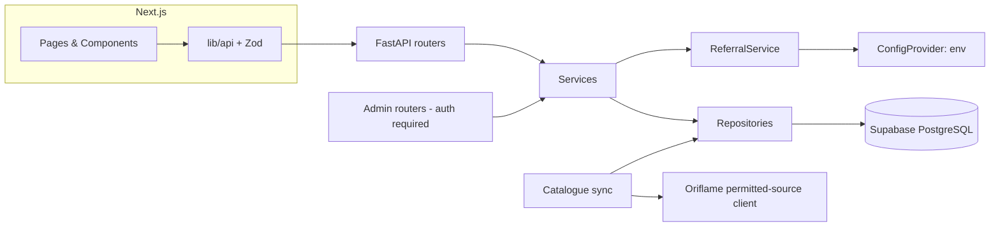

# System Architecture — Oriflame Pakistan Referral Store

**Version:** 0.1.0 | **Last Updated:** October 2026

---

## Overview

A single-vendor product discovery and referral storefront. Visitors browse a catalogue of Oriflame Pakistan products sourced from permitted, reliable sources, build a local shopping list, and are handed off to the official Oriflame Pakistan shopping/checkout experience via the owner's configured referral destination. The site is independent and not the official Oriflame website.

This is the first version of a future Micro-SaaS. Multi-tenancy, vendor management, subscription billing, and multi-vendor features are **out of scope** for this phase — but the code must be modular enough to introduce tenant-aware configuration later without rewriting core catalogue or referral services.

---

## Component Stack

| Component | Technology | Responsibility |
|---|---|---|
| Frontend | Next.js App Router, React, TypeScript, Tailwind, shadcn/ui | Presentation, SEO metadata, local shopping list |
| API client | `frontend/lib/api/` + Zod | Typed, validated backend access |
| Backend API | FastAPI, Pydantic | Routers, validation, pagination, admin auth |
| Services | Python | Business logic (`ProductService`, `AvailabilityService`, `ReferralService`) |
| Repositories | SQLAlchemy 2.x | Parameterised data access |
| Database | Supabase (PostgreSQL) + Alembic | Catalogue, sync runs, admin, audit, referral clicks |
| Integration | `integrations/oriflame/` | Permitted-source client + catalogue sync |
| Configuration | Pydantic Settings via `ConfigProvider` | Env-based referral + app config |

---

## Boundaries

Keep a clear separation between:

- Frontend presentation and API client code.
- FastAPI routers, schemas, services, repositories, and database models.
- External Oriflame integration code.
- Referral configuration and referral URL generation.
- Product catalogue synchronisation.
- Admin-only functionality.



---

## Data Flow

1. **Catalogue sync** — the integration client reads a permitted source; `catalogue.py` performs idempotent upserts keyed on stable source ids, stores `source_url` and `last_synced_at`, and records a `catalogue_sync_runs` row.
2. **Browse** — Next.js Server Components fetch paginated products/categories/search from the API and validate with Zod.
3. **Shortlist** — the visitor adds items to a local (browser) shopping list.
4. **Handoff** — the frontend requests the referral destination; `ReferralService` resolves it server-side from configuration, validates the host, records a click, and returns either the official referral URL or manual-code instructions.
5. **Checkout** — happens entirely on Oriflame's official platform. No payment or address data touches this system.

---

## Configuration Provider

```text
ConfigProvider (interface)
 └── EnvConfigProvider        # MVP — reads Pydantic Settings
 └── (future) DbConfigProvider # may override env per tenant — not built now
```

Define the interface only if it remains lightweight. Do not build a settings database/UI unless requested.

---

## Error Handling & Resilience

| Concern | Approach |
|---|---|
| Outbound source calls | Explicit timeouts; retries with backoff for idempotent reads |
| Sync failures | Recorded on the sync-run row; safe to retry; no duplicates |
| Missing referral config | Handoff degrades to "configuration unavailable" messaging; admin status shows misconfiguration |
| Stale availability | Labelled "Availability not confirmed" — never presented as real-time |
| API errors | Safe client messages; detailed structured logs server-side |

---

## Future Multi-Tenant Seam (not implemented)

- Services take configuration through `ConfigProvider`, not globals.
- No tenant tables now; adding a tenant id later should touch providers, repositories, and migrations — not catalogue or referral business logic.

---

*System Architecture — Version 0.1.0 — October 2026*
