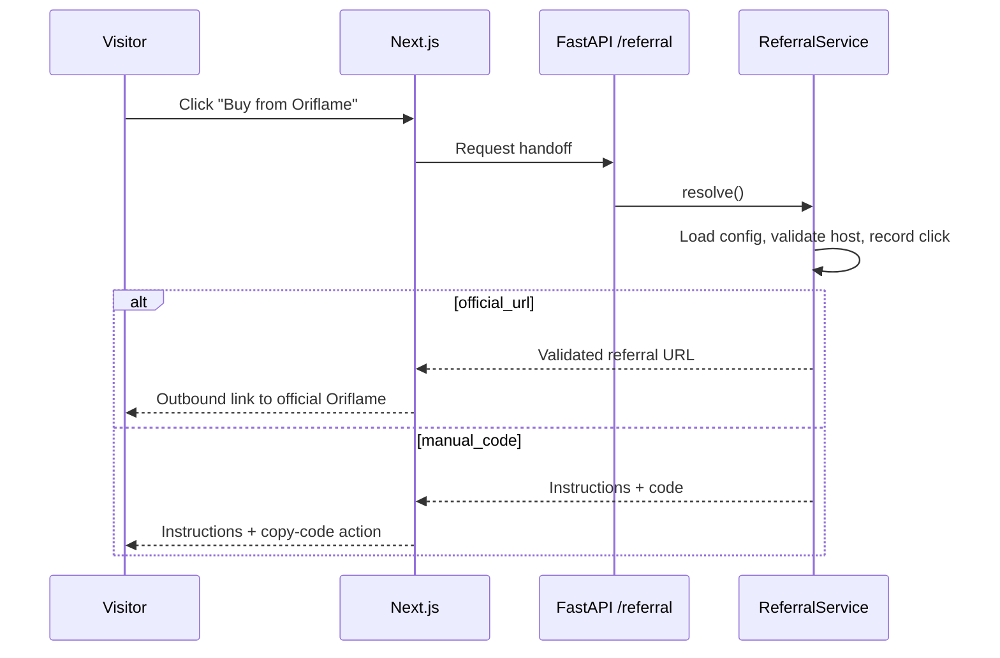

# Referral Configuration & Handoff — Oriflame Pakistan Referral Store

**Version:** 0.1.0 | **Last Updated:** October 2026

---

## Principle

The referral code and referral URL are **configuration, not constants in application source**. The initial owner is one vendor whose Oriflame referral/consultant code and referral URL must be configurable without hardcoding them.

---

## Configuration (MVP: environment variables)

```dotenv
# Backend
POSTGRES_URL=postgresql://postgres.<project-ref>:<password>@aws-0-<region>.pooler.supabase.com:5432/postgres
APP_ENV=development
CORS_ORIGINS=http://localhost:3000

# Referral configuration — replace with real, approved values
ORIFLAME_COUNTRY=PK
ORIFLAME_CONSULTANT_CODE=
ORIFLAME_REFERRAL_URL=
ORIFLAME_REFERRAL_METHOD=official_url
```

| Variable | Meaning |
|---|---|
| `ORIFLAME_COUNTRY` | Market (`PK`) |
| `ORIFLAME_CONSULTANT_CODE` | Owner's consultant/referral code — server-side only |
| `ORIFLAME_REFERRAL_URL` | Official referral URL supplied/approved by Oriflame |
| `ORIFLAME_REFERRAL_METHOD` | `official_url` (redirect to referral URL) or `manual_code` (instruct visitor to enter code at checkout) |

### Allowed referral hosts

`ORIFLAME_REFERRAL_URL` must use `https` and its host must exactly match an entry in `ALLOWED_REFERRAL_HOSTS` (`backend/app/core/config.py`). Confirmed with the owner (October 2026):

| Host | Notes |
|---|---|
| `pk.oriflame.com` | Oriflame Pakistan, the only allowed host |

Subdomain wildcards are not allowed, and neither are URLs with embedded credentials. Adding a host is a code change plus an update to this table, made only after the owner confirms it.

### Validation (OR-002)

- `Settings` (Pydantic Settings) loads the variables once; services read them through `ConfigProvider.get_referral_config()` and never from `os.environ`.
- Empty `ORIFLAME_CONSULTANT_CODE` / `ORIFLAME_REFERRAL_URL` are treated as unset. Startup still succeeds, and `ReferralConfig.is_configured` reports `False`.
- `ORIFLAME_REFERRAL_METHOD=manual_code` without `ORIFLAME_CONSULTANT_CODE` fails at startup, and so does an unknown method.
- The consultant code is a `SecretStr`, so it never appears in a repr, a log or a `model_dump`.

---

## Requirements

- Commit `.env.example` only; never commit `.env` or real credentials/codes.
- Add `.env`, local secrets, and generated files to `.gitignore`.
- Load backend configuration through a typed settings class (Pydantic Settings).
- Never expose private environment variables to the browser or use a `NEXT_PUBLIC_` prefix for the consultant code unless it is confirmed to be intentionally public.
- The referral URL may be rendered as a public outbound link when needed, but resolve it on the server and validate its allowed host.
- Do not assume that appending a consultant code to an arbitrary URL creates attribution.
- Use only an official referral URL or a documented, permitted referral mechanism.
- If the official checkout requires manual code entry, show clear instructions and a copy-code action.
- Do not state that a sale was attributed unless Oriflame confirms it.
- Centralise referral handling in a `ReferralService`; do not construct referral URLs in UI components.
- For a future admin-editable setting, define a configuration-provider interface now if it remains lightweight. Environment variables are the initial provider. A future database-backed provider may override them, but do not build a settings database/UI unless requested.

---

## Handoff Flow



Copy shown to visitors must state that checkout and fulfilment happen on Oriflame's official platform and must not claim attribution.

---

## Admin Visibility

The admin area shows referral **configuration status** (configured / missing / invalid host) and basic click analytics. While configuration is environment-based, do not create a misleading editable form that cannot persist changes — explain that updates are made through deployment environment settings.

---

## Required Tests

- Referral URL generation and host allow-list validation
- `manual_code` path returns instructions and code
- Missing/invalid configuration fails safely
- Consultant code never appears in client bundles or public env

---

*Referral Configuration — Version 0.1.0 — October 2026*
